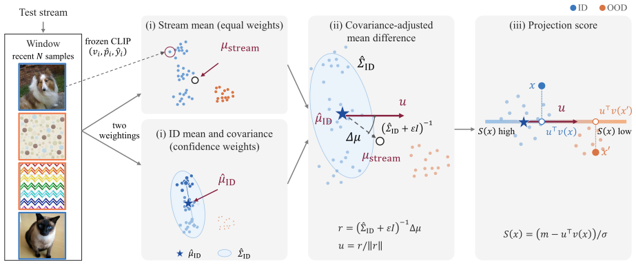

# CAMP: Selection-Free Test-Time OOD Detection with Vision-Language Models

[](LICENSE)
[](environment.yml)
[](requirements.txt)
<!-- TODO after publication: [](https://arxiv.org/abs/XXXX.XXXXX) -->

Official PyTorch implementation of **CAMP** by Hyunwoo Park, Saerin Lim and Seoung Bum Kim (Korea University).
<!-- TODO: paper link -->

<p align="center">
  
</p>

CAMP detects out-of-distribution (OOD) inputs in a test stream with a **frozen CLIP** model. It needs no training, no
in-distribution (ID) data, no test-time optimization and no sample selection: everything is read off a sliding window
of the stream itself.

- **Two means of one window.** The plain mean of the recent test samples (stream mean) and their confidence-weighted,
  class-balanced mean (approximate ID mean) drift apart as OOD samples arrive.
- **Covariance-adjusted projection.** The mean difference is adjusted by the ID covariance of the same window,
  `u = (Σ + εI)⁻¹ (μ_stream − μ_ID)`, and each sample is scored by its projection `−uᵀ f(x)` onto that direction.
- **Drop-in.** CAMP is a postprocessor of a frozen CLIP: it runs on any CLIP backbone, and its standardized score can
  be added to another detector's score with one config switch.

**Contents** · [Installation](#installation) · [Data preparation](#data-preparation) · [Quick start](#quick-start) ·
[Method configuration](#method-configuration) · [Reproducing the paper](#reproducing-the-paper) · [Results](#results) ·
[Repository structure](#repository-structure) · [Acknowledgements](#acknowledgements) · [License](#license) ·
[Citation](#citation)

## Installation

Python ≥ 3.10 and PyTorch ≥ 2.1 on a CUDA GPU. The paper's runs used PyTorch 2.1 with CUDA 12.1.

```bash
git clone https://github.com/hwoop/CAMP.git && cd CAMP
conda env create -f environment.yml && conda activate camp   # or, in an existing environment: pip install -r requirements.txt
```

CLIP weights are downloaded to `~/.cache/clip` on first use (ViT-B/16 by default; ViT-B/32, ViT-L/14 and RN50 are
configured under [`configs/networks/`](configs/networks/)).

## Data preparation

Datasets, splits and image lists follow [OpenOOD v1.5](https://github.com/Jingkang50/OpenOOD). One script fetches the
image lists and every dataset of the four benchmarks below from OpenOOD's Google Drive into `data/`:

```bash
bash scripts/download/download.sh          # OpenOOD v1.5 image lists + datasets -> data/ (gdown)
python scripts/make_imagenet_test_all.py   # ID list of the ImageNet-1K benchmark (see below)
```

The ImageNet-1K benchmark of MCM / NegLabel uses the whole ILSVRC-2012 validation set (50,000 images) as ID, whereas
OpenOOD's ImageNet-1K benchmark uses 45,000 of them. The second command writes the 50,000-image list
`test_imagenet_all.txt` by joining OpenOOD's `test_imagenet.txt` and `val_imagenet.txt`. If a Google Drive download
stops with a quota error, rerun the script later; finished files are kept.

| Benchmark | ID | Near-OOD | Far-OOD |
|---|---|---|---|
| `imagenet_openood` | ImageNet-1K (45,000) | SSB-hard, NINCO | iNaturalist, Textures, OpenImage-O |
| `imagenet_standard` | ImageNet-1K (50,000) | | iNaturalist, SUN, Places, Textures |
| `cifar10_openood` | CIFAR-10 | CIFAR-100, TinyImageNet | MNIST, SVHN, Textures, Places365 |
| `cifar100_openood` | CIFAR-100 | CIFAR-10, TinyImageNet | MNIST, SVHN, Textures, Places365 |

Expected layout after the download:

```text
data/
├── benchmark_imglist/{imagenet,cifar10,cifar100}/        # image lists
├── images_largescale/{imagenet_1k,ssb_hard,ninco,inaturalist,openimage_o,sun,places,dtd}/
├── images_classic/{cifar10,cifar100,tin,mnist,svhn,texture,places365}/
└── txtfiles/                                             # WordNet word lists of the negative-label methods (in the repository)
```

## Quick start

```bash
bash scripts/run.sh camp imagenet_openood 0   # CAMP on the OpenOOD ImageNet-1K benchmark, seed 0
python scripts/summarize.py --leaves          # FPR@95 / AUROC of every recorded run, mean (std) over seeds
```

`scripts/run.sh <method> <benchmark> [seed ...]` runs one method on one benchmark; without seeds it runs seeds
`0 1 42`. Methods: `camp` and the compared detectors `mcm`, `neglabel`, `csp`, `tanl`, `adaneg`, `oodd`, `coevo`.
`bash scripts/run_all.sh` runs every method on every benchmark and skips finished runs, so it can be restarted.

| Variable | Default | Meaning |
|---|---|---|
| `BACKBONE` | `vitb16` | `vitb32`, `vitl14` or `rn50` select another CLIP backbone |
| `CUDA_VISIBLE_DEVICES` | `0` | the GPU to run on |
| `NUM_WORKERS` | `8` | data-loader workers |
| `DRY_RUN` | unset | `DRY_RUN=1` prints the `main.py` commands without running them |

A run writes `results/<dataset>_vanilla_clip_test_ood_ood_clip_tta_<method>/<benchmark>[_<backbone>]-s<seed>/` with
`ood.csv` (FPR@95, AUROC, AUPR and accuracy per OOD set and per group), `scores/<ood set>.npz`, `config.yml` and
`log.txt`. Image features are cached under `.cache/` after the first run of a benchmark, so every further method,
seed or experiment on the same backbone skips the image encoder.

## Method configuration

CAMP lives in [`openood/postprocessors/camp/`](openood/postprocessors/camp/) (`window.py` the sliding window,
`geometry.py` the two means, the covariance and the direction, `scores.py` the projection and standardization,
`postprocessor.py` the OpenOOD glue). Its settings are in
[`configs/postprocessors/camp/default.yml`](configs/postprocessors/camp/default.yml):

| Key | Default | Meaning |
|---|---|---|
| `camp.window_size` | `8192` | window length `N` |
| `camp.min_samples` | `512` | warm-up `N_min`: before it, the batch is scored by the warm-up detector below |
| `camp.shift_eps` | `0.001` | ridge constant `ε` of the covariance adjustment |
| `camp.covariance` | `full` | `identity` drops the covariance adjustment |
| `camp.id_reference` | `classwise` | `global` drops the class balancing of the ID mean |
| `camp.weighting` | `msp` | `uniform` drops the confidence weighting |
| `semantic.method` | `mcm` | the warm-up detector (`mcm`, `neglabel`, `csp`, `tanl`, `adaneg`, `oodd`, `coevo`) |
| `fusion.semantic_weight` | `0.0` | `1.0` adds CAMP's standardized score to the warm-up detector's: `z(S) + z(R)` |

Override a key on the command line, for example `--postprocessor.postprocessor_args.camp.window_size 4096`, or append
an overlay YAML to `--config`; [`scripts/experiment/README.md`](scripts/experiment/README.md#custom-runs) shows both.
Per-sample and per-batch diagnostics can be recorded without changing any score
([`configs/diagnostics/`](configs/diagnostics/)).

## Reproducing the paper

Every table and figure of the paper is an *item* of the experiment driver. An item knows which runs it needs, launches
the missing ones, and writes its tables and figures under `results/experiment/<item>/`:

```bash
python -m scripts.experiment list                 # every item with its benchmarks and seeds
python -m scripts.experiment main_results all     # run the missing main-table runs, write the tables
python -m scripts.experiment sensitivity all      # one item: run, analyze, figure
```

[`scripts/experiment/README.md`](scripts/experiment/README.md) lists every item (ablations, backbones, sensitivity,
OOD-ratio and warm-up studies, the analyses of the window estimate, and the timing measurement) with their options.

## Results

Frozen CLIP ViT-B/16, mean over seeds 0, 1 and 42, as written by `bash scripts/run_all.sh` and
`python scripts/summarize.py`. The compared methods were re-run with their official code under the same stream
protocol. FPR@95 follows the OpenOOD evaluator (OOD is the positive class), so values can differ from the methods'
papers. Bold marks the best value in each column.

**ImageNet-1K benchmark** (`imagenet_standard`, %)

| Method | iNaturalist FPR@95↓ | AUROC↑ | SUN FPR@95↓ | AUROC↑ | Places FPR@95↓ | AUROC↑ | Textures FPR@95↓ | AUROC↑ | Average FPR@95↓ | AUROC↑ |
|---|---|---|---|---|---|---|---|---|---|---|
| MCM | 29.38 | 91.73 | 33.51 | 91.42 | 47.56 | 87.91 | 49.64 | 86.52 | 40.02 | 89.40 |
| NegLabel | 1.28 | 99.52 | 21.54 | 95.43 | 38.67 | 92.13 | 38.18 | 91.11 | 24.92 | 94.55 |
| CSP | 0.93 | 99.62 | 16.44 | 96.59 | 37.99 | 92.70 | 32.99 | 94.14 | 22.09 | 95.76 |
| AdaNeg | 0.69 | 99.71 | 11.51 | 97.18 | 34.10 | 94.13 | 28.72 | 94.78 | 18.76 | 96.45 |
| OODD | 0.65 | 99.81 | 12.58 | 97.10 | 37.53 | 92.64 | 18.83 | 95.36 | 17.39 | 96.23 |
| CoEvo | **0.43** | 99.79 | 4.95 | 98.43 | 26.43 | 95.61 | 16.85 | 96.71 | 12.17 | 97.63 |
| TANL | 0.45 | **99.84** | **3.81** | **98.97** | 21.33 | 95.62 | 14.32 | 96.74 | 9.98 | 97.79 |
| **CAMP (Proposed)** | 0.81 | 99.75 | 4.11 | 98.77 | **7.94** | **98.02** | **8.35** | **98.15** | **5.30** | **98.67** |

**OpenOOD ImageNet-1K benchmark** (`imagenet_openood`, %)

| Method | Near-OOD FPR@95↓ | AUROC↑ | Far-OOD FPR@95↓ | AUROC↑ |
|---|---|---|---|---|
| MCM | 77.09 | 69.05 | 36.55 | 90.05 |
| NegLabel | 67.99 | 75.33 | 23.50 | 94.92 |
| CSP | 69.87 | 75.01 | 18.81 | 96.16 |
| AdaNeg | 68.19 | 76.50 | 17.27 | 96.46 |
| OODD | 77.17 | 75.81 | 29.25 | 94.85 |
| CoEvo | 68.38 | 74.01 | 16.53 | 96.50 |
| TANL | 59.64 | 84.60 | 17.05 | 96.25 |
| **CAMP (Proposed)** | **46.05** | **90.05** | **12.52** | **97.39** |

**OpenOOD CIFAR-10 / CIFAR-100 benchmarks** (%)

| Method | CIFAR-10 Near FPR@95↓ | AUROC↑ | CIFAR-10 Far FPR@95↓ | AUROC↑ | CIFAR-100 Near FPR@95↓ | AUROC↑ | CIFAR-100 Far FPR@95↓ | AUROC↑ |
|---|---|---|---|---|---|---|---|---|
| MCM | 32.49 | 91.50 | 19.07 | 95.60 | 77.42 | 68.65 | 53.62 | 77.74 |
| NegLabel | 30.42 | 93.78 | 18.36 | 95.80 | 77.52 | 71.91 | 62.53 | 77.98 |
| CSP | **28.34** | 94.00 | 13.83 | 95.87 | 74.37 | 72.20 | 53.41 | 79.27 |
| AdaNeg | 28.66 | **94.56** | 6.86 | 98.35 | 71.42 | 77.57 | 41.26 | 89.49 |
| OODD | 33.96 | 91.16 | 19.81 | 94.98 | 82.31 | 69.21 | 63.59 | 75.46 |
| CoEvo | 29.46 | 94.30 | 6.72 | 98.39 | 71.23 | 77.31 | 41.16 | 90.52 |
| TANL | 36.59 | 91.79 | 9.32 | 98.16 | 74.76 | 73.40 | 34.78 | 92.34 |
| **CAMP (Proposed)** | 29.65 | 93.62 | **3.52** | **99.29** | **55.26** | **88.13** | **27.63** | **95.00** |

## Repository structure

```text
configs/            dataset, network, pipeline and postprocessor configs (OpenOOD style); diagnostics/ overlays
data/               datasets and image lists (downloaded); txtfiles/ WordNet word lists (tracked)
openood/            the OpenOOD framework: datasets, CLIP networks, the stream evaluator, postprocessors
  postprocessors/camp/     CAMP
  postprocessors/<method>/ the compared methods, from their official code
scripts/run.sh, run_all.sh, summarize.py   one run, all runs, the result table
scripts/download/   OpenOOD's download script
scripts/experiment/ the paper's tables and figures, one package per item
results/, .cache/   run outputs and cached image features (not tracked)
```

## Acknowledgements

This repository builds on [OpenOOD](https://github.com/Jingkang50/OpenOOD) and
[OpenOOD-VLM](https://github.com/PolyU-VCLab/OpenOOD-VLM), and uses OpenAI's [CLIP](https://github.com/openai/CLIP).
The compared methods are run from their authors' code:
[MCM](https://github.com/deeplearning-wisc/MCM), [NegLabel](https://github.com/tmlr-group/NegLabel),
[CSP](https://github.com/MengyuanChen21/NeurIPS2024-CSP), [AdaNeg](https://github.com/PolyU-VCLab/OpenOOD-VLM),
[TANL](https://github.com/PolyU-VCLab/OpenOOD-VLM), [OODD](https://github.com/zxk1212/OODD) and
[CoEvo](https://github.com/yuleoliu/CoEvo). We sincerely thank the authors.

## License

CAMP is released under the [MIT License](LICENSE). The third-party code and data in this repository keep their own
licenses, listed in [`NOTICE.md`](NOTICE.md).

## Citation

```bibtex
@unpublished{park2026camp,
  title  = {{CAMP}: Selection-Free Test-Time Out-of-Distribution Detection with Vision-Language Models},
  author = {Park, Hyunwoo and Lim, Saerin and Kim, Seoung Bum},
  year   = {2026},
  note   = {Unpublished manuscript}
}
```
